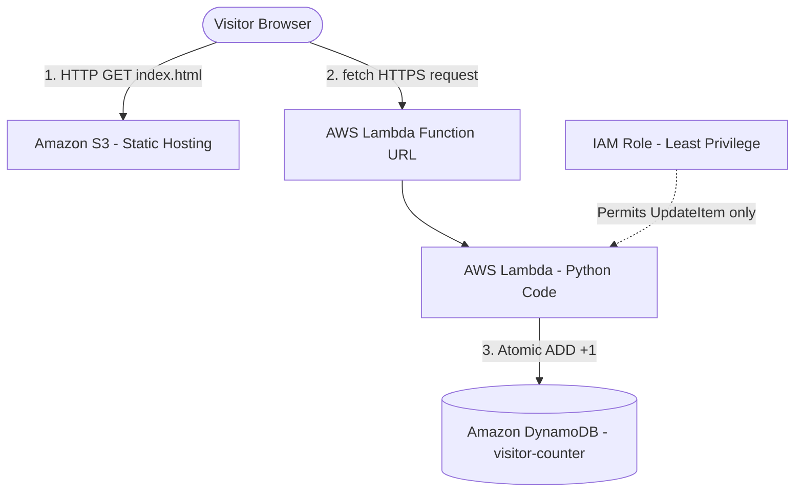
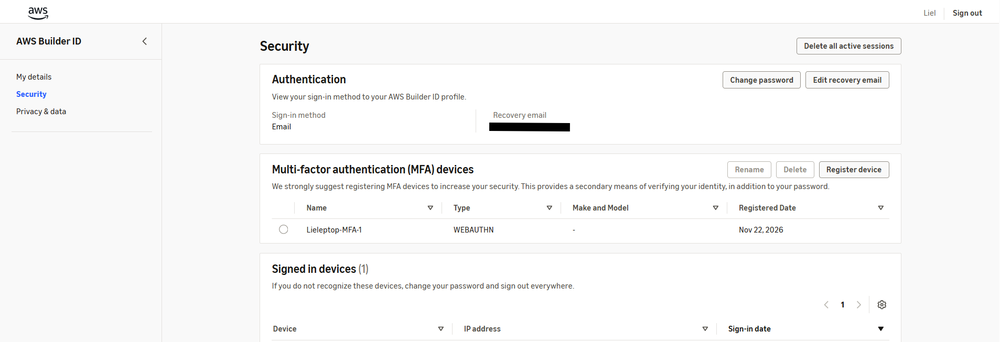
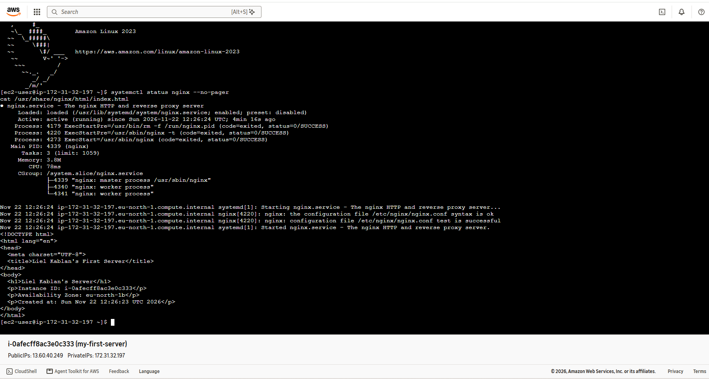
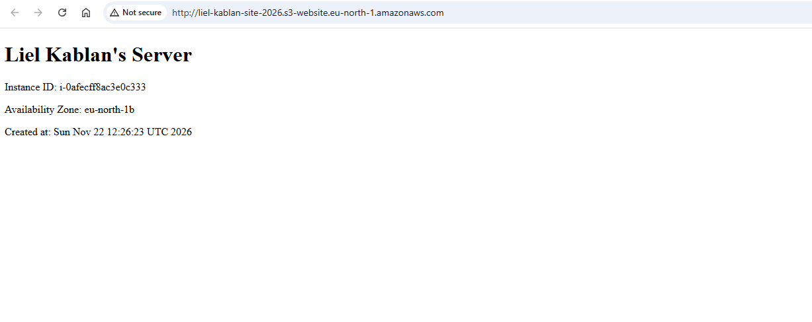

# AWS Cloud Migration Challenge — Liel Kablan

A complete cloud migration project on Amazon Web Services (AWS): transitioning from managing a traditional virtual server (EC2) to a modern, cost-effective Serverless architecture utilizing Amazon S3, AWS Lambda, and Amazon DynamoDB.

---

## 🔗 Live Demo
[Liel Kablan's Cloud Architecture Page](http://liel-kablan-site-2026.s3-website.eu-north-1.amazonaws.com)

---

## Architecture Overview
1. **Frontend (Static Hosting):** HTML page hosted publicly on **Amazon S3**.
2. **Backend (Serverless Logic):** Python **AWS Lambda** function triggered via **Function URL**.
3. **Database (NoSQL):** **Amazon DynamoDB** table (`visitor-counter`) maintaining an atomic live visitor count.
4. **Security & IAM:** **Least Privilege Access** policy granting Lambda update permissions exclusively to the DynamoDB table.

---

## Serverless Architecture Diagram

---

## Screenshots & Evidence

##### Phase 1: Secured Account (MFA & IAM)

##### Phase 2: Nginx Web Server on EC2

##### Phase 3: SSH Diagnostic & Nginx Status

##### Phase 4: Serverless Live Visitor Counter on S3

##### Phase 5: Decommissioned Legacy Server (EC2 Terminated)

---

## Key Takeaways & Reflection

1. **What Surprised Me Most:** What surprised me most was learning how websites actually work behind the scenes in the cloud, and how easy it was to host the site on S3.
2. **EC2 vs. Lambda in My Own Words:** In my own words, EC2 is like a whole computer running 24/7 that I have to manage, while Lambda is just code that wakes up for a second only when someone visits the site.
3. **Question for the Session:** What happens to the performance and costs if a million people visit the site all at once?

---

## EC2 vs. AWS Lambda Comparison

| Feature | Amazon EC2 (Virtual Server) | AWS Lambda (Serverless) |
| :--- | :--- | :--- |
| **What I Managed** | Full Linux OS, `nginx` web server, and firewall ports (Security Group) | Only the Python function code (`lambda_function.py`) |
| **Pricing Model** | Pay continuously for every hour the server is running, even with 0 visitors | Pay-per-use: charged only for the milliseconds the code runs when someone visits |
| **Security Updates** | **My responsibility** to patch and update the OS (`Shared Responsibility`) | **AWS's responsibility** to manage and patch the underlying infrastructure |
| **Handling Traffic Spikes** | Single `t3.micro` server has fixed resources and can crash under heavy load | Automatically scales out in parallel for each incoming request |
