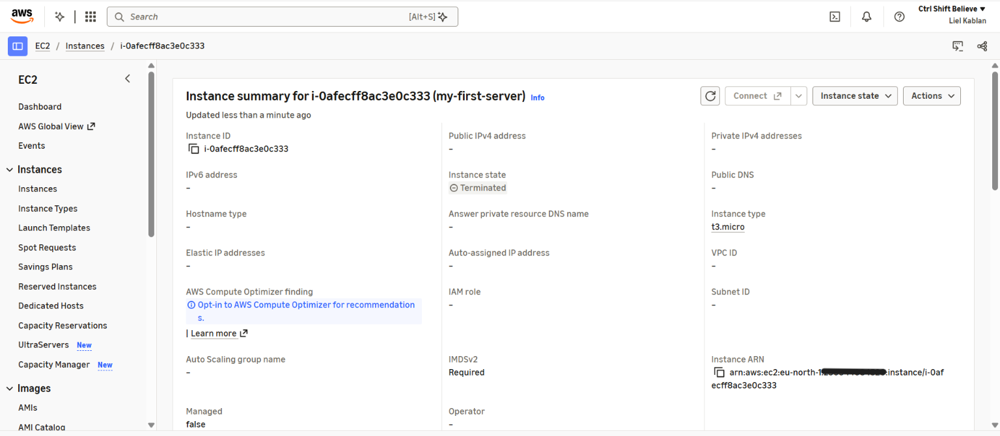

# AWS Cloud Migration Challenge — Liel Kablan

A complete cloud migration project on Amazon Web Services (AWS): transitioning from managing a traditional virtual server (EC2) to a modern, cost-effective Serverless architecture utilizing Amazon S3, AWS Lambda, and Amazon DynamoDB.

---

## 🔗 Live Demo
[Liel Kablan's Cloud Architecture Page](http://liel-kablan-site-2026.s3-website.eu-north-1.amazonaws.com)

---

## 🏗️ Architecture Overview
1. **Frontend (Static Hosting):** HTML page hosted publicly on **Amazon S3**.
2. **Backend (Serverless Logic):** Python **AWS Lambda** function triggered via **Function URL**.
3. **Database (NoSQL):** **Amazon DynamoDB** table (`visitor-counter`) maintaining an atomic live visitor count.
4. **Security & IAM:** **Least Privilege Access** policy granting Lambda update permissions exclusively to the DynamoDB table.

---

## 📸 Screenshots & Evidence

### Phase 1: Secured Account (MFA & IAM)

### Phase 2: Nginx Web Server on EC2

### Phase 3: SSH Diagnostic & Nginx Status

### Phase 4: Serverless Live Visitor Counter on S3

### Phase 5: Decommissioned Legacy Server (EC2 Terminated)

---

## ✍️ Key Takeaways & Reflection

1. **What Surprised Me Most:** I was surprised by how quickly and seamlessly a fully event-driven, serverless architecture can be deployed compared to the time, manual configuration, and maintenance required for a standalone virtual server.
2. **EC2 vs. Lambda in My Own Words:** With EC2, you rent a dedicated virtual machine and are responsible for OS management, security patches, and 24/7 running costs. With Lambda, you only bring your code—AWS manages the underlying infrastructure and scales automatically on demand.
3. **Question for the Session:** What are the industry best practices for version control, continuous integration/deployment (CI/CD), and environment management in multi-user Serverless environments?
